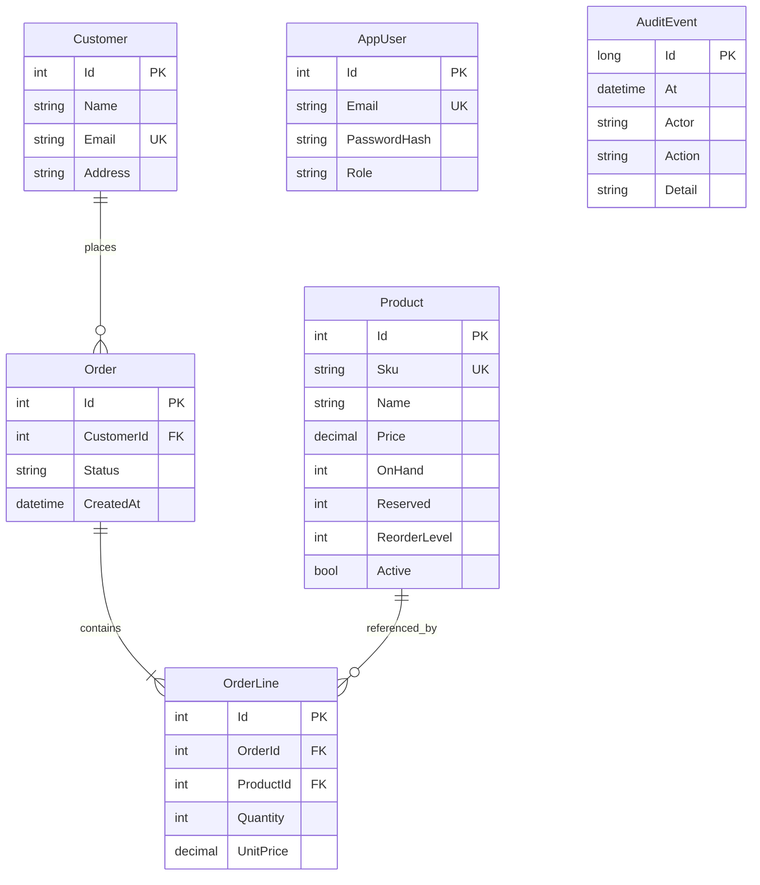

# Design decisions

StockFlow is a modular monolith: a single ASP.NET Core host serves the REST API and interactive Blazor Server UI. Data, transactional operations, and UI are separate modules. EF Core handles CRUD; parameterised SQL handles guarded stock updates and reports.

## Stock invariant

`0 <= Reserved <= OnHand`; available is `OnHand - Reserved`. Drafts hold nothing. Confirmation reserves every line atomically. Shipment subtracts both physical and reserved stock. Cancelling a confirmed order releases its reservation; cancelling a draft changes no stock. Shipped and cancelled orders are terminal. Repeating the same successful target state is idempotent.

Each transition acquires an update lock on its order row. This serializes competing commands for the same order and avoids double release/shipment. Lines are processed in product ID order, reducing deadlock opportunities. An atomic `UPDATE ... WHERE OnHand - Reserved >= quantity` acquires SQL Server write locks and rechecks availability after a competing writer commits. Exactly one update can reserve the final unit. A zero affected-row count returns HTTP 409 and the enclosing transaction rolls back every line. The audit event and order status commit with the stock changes. Check constraints provide a second enforcement layer.

There is no process-local lock and no assumption of a single app replica. A SQL deadlock victim gets a retryable 409 rather than an automatic unsafe replay. Use the same order ID when retrying a transition. Order creation and stock receipts are not idempotent; do not retry them automatically after an ambiguous network failure.

Price is captured per line when a draft is created. Changing catalogue prices cannot rewrite historical order totals. This version deliberately has immutable draft lines; cancel and recreate a draft to change its contents. Product deletion is archival to preserve historical relationships. Existing reservations may still ship after archival. There are no returns, refunds, tax, discounts or multi-currency accounting; all monetary values are GBP, two decimal places. Revenue is grouped by order creation month for shipped orders, not shipment accounting periods.

## Security

Passwords are hashed using ASP.NET Core's PasswordHasher. HTTP-only, SameSite Strict cookies expire after eight hours. Mutating API requests require ASP.NET antiforgery tokens. The login route is rate limited. Admins manage the product catalogue and inspect the audit log; staff can manage customers, receive stock, create and fulfil orders, and read reports. Both roles see customer contact information. New accounts are provisioned from seed environment variables at first launch; no public registration. Existing password hashes are not overwritten by changing seed variables.

A production deployment needs HTTPS termination, a least-privilege SQL login, managed secrets, backups, persistent/shared Data Protection keys, and an explicit account lifecycle/password reset policy. Compose is a local demo, with loopback-only exposed ports and SA credentials for bootstrapping. Never expose SQL Server to the public internet. Login rate limiting is per application instance. Audit history is append-only through the API, but a database administrator can change it; it is not a tamper-evident compliance ledger.

## Data model

## Query design

Unique SKU and customer email indexes enforce business uniqueness. `(Status, CreatedAt)` supports status-filtered order lists and sales date filters; unique `(OrderId, ProductId)` prevents duplicate order lines. Lists are bounded, deterministic and paginated; `%term%` searches are convenient for a small business catalogue but are not index seeks. Larger catalogues should use full-text search or a prefix-search contract. Reports use joins, CTEs and window functions (running revenue and dense product rank).

`sql/benchmark.sql` provides a reproducible before/after experiment with actual XML execution plans, logical reads and timing. See `docs/benchmark-results.md` for measured results from this workspace. The benchmark is a synthetic order-header query, not an end-to-end report latency claim.

## Schema lifecycle

The initial demo uses EF `EnsureCreated` on an empty database. It does not upgrade an existing schema. `sql/schema.sql` is the generated initial SQL schema. For ongoing production development, adopt EF migrations with a reviewed deployment step; do not mix EnsureCreated and migrations on an existing database. Schema generation/initialisation is a single deployment task, not something to run concurrently on multiple replicas.
